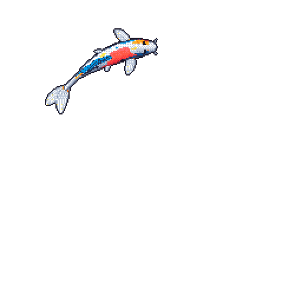

<!--
**dividurga/dividurga** is a ✨ _special_ ✨ repository because its `README.md` (this file) appears on your GitHub profile.

Here are some ideas to get you started:

- 🔭 I’m currently working on ...
- 🌱 I’m currently learning ...
- 👯 I’m looking to collaborate on ...
- 🤔 I’m looking for help with ...
- 💬 Ask me about ...
- 📫 How to reach me: ...
- 😄 Pronouns: ...
- ⚡ Fun fact: ...
-->
Hi! I'm Divija, and I'm a current undergraduate in Electrical and Computer Engineering at Princeton University. In this github, you'll find a bunch of firmware and software for personal projects, as well as code for some work I've done for my classes. You can find more about some of my projects on my [blog](https://divija.info/category/machines)!
